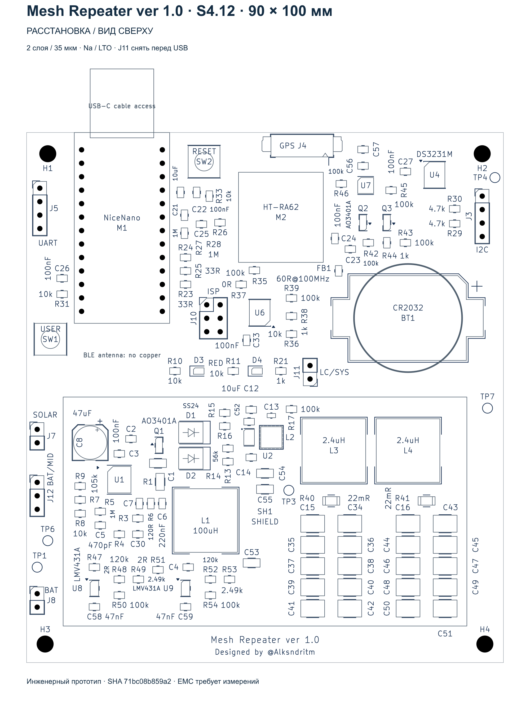

# Mesh Repeater ver 1.0

**Designed by @Alksndritm**

Двухслойная плата репитера MeshCore для Nice!Nano-совместимого nRF52840-модуля и модема Heltec HT-RA62. Проект использует FakeTec 6c как пример и сохраняет распиновку MeshCore FakeTec / ProMicro, добавляя солнечное питание, варианты аккумуляторов, часы и аппаратный watchdog.

Текущая редакция CAD — **S4.12 от 10 октября 2026 года**. Это инженерный прототип: проверки схемы и топологии выполнены, стендовые испытания и пакет выпуска для производства ещё не завершены.



## Основные узлы

- Плата 90 × 100 мм, два слоя, FR4 1,6 мм; проект рассчитан на готовую наружную медь 35 мкм. В проекте 136 физических позиций, включая опциональные детали и контрольные точки.
- CN3722: заряд от солнечной панели класса 12 В. Вариант по умолчанию — Na-ion 1S; альтернативная сборка — LTO 2S. Шунт R1 0,28 Ом задаёт основной ток около 714 мА; расчётный верхний угол — около 784 мА. USB используется для питания и прошивки.
- TPS63802 формирует 3,3 В. После локальной выходной развязки расположен двухкаскадный LC-фильтр: два CDRH127/LDNP-2R4NC по 2,4 мкГн и два банка по 10 × 100 мкФ керамики. R40/R41 по 22 мОм включены последовательно только с конденсаторными банками; ток нагрузки через них не проходит. Требование к каждому банку — не менее 330 мкФ эффективной ёмкости при 3,3 В.
- Модем получает питание отдельной ветвью от J11 через FB1 и местные C23/C24. Nice!Nano, RTC и GPS подключены отдельной ветвью SYS_3V3 до феррита. Земля общая и связная.
- DS3231MZ+TRL с батареей CR2032; батарея часов не заряжается. RTC подключён по I²C, внешний сигнал alarm не используется.
- Разъём GPS — восьмиконтактный PicoBlade 1,25 мм с электрическим порядком контактов Heltec T114 V2.1. GPIO P0.24 включает основное питание GPS; резервное питание сохраняется. RESET_N, PPS и WAKE_UP на этом разъёме не используются.
- ATtiny13A контролирует активность TXEN модема. При отсутствии зарегистрированных передач около трёх часов выдаётся низкий импульс сброса MCU примерно на одну секунду. После сброса MCU должен заново инициализировать модем.
- Зарядник, преобразователь и опциональный балансир размещены внутри рамки SH1. Проектная крышка имеет внутреннюю высоту 14 мм; её посадку и охлаждение нужно проверить на образце.

## Открыть проект

Проверенная версия редактора — **KiCad 10.0.6**. Откройте [Meshcore_NaIon.kicad_pro](design/Meshcore_NaIon/Meshcore_NaIon.kicad_pro) и затем схему или плату из менеджера проекта. Сохраняйте весь каталог проекта: рядом находятся локальные библиотеки символов, посадочных мест и 3D-модели. В редакторе платы `Alt+3` открывает 3D-вид. Установите стандартные библиотеки KiCad 10, включая 3D-модели: 19 стандартных моделей остаются зависимостью `${KICAD10_3DMODEL_DIR}`; 14 нужных локальных STEP находятся в проекте.

- [Схема KiCad](design/Meshcore_NaIon/Meshcore_NaIon.kicad_sch) — корневой лист и пять дочерних листов.
- [Плата KiCad](design/Meshcore_NaIon/Meshcore_NaIon.kicad_pcb).
- [Схема PDF](output/pdf/S4_12_schematic.pdf).
- [Закупочный список](bom/shopping.csv) и [уточнения закупки](bom/NOTES_RU.txt).
- [Варианты сборки и компоненты](design/Meshcore_NaIon/assembly_variants_S4_12.csv).
- [Описание изменений S4.12](output/S4_12_CHANGES_RU.html).
- [Финальные проверки CAD](audit/s4_12_user_refinements_20261010/acceptance.json).
- [Исходник watchdog](design/watchdog_reference/main.c) и [Makefile](design/watchdog_reference/Makefile).

Модели Nice!Nano, HT-RA62 и крышки упрощены для визуализации. Они не подтверждают механическую совместимость конкретного купленного клона, кабеля или изготовленной крышки.

## Варианты сборки

| Позиция | Na-ion 1S | LTO 2S |
|---|---|---|
| R3, верхний резистор FB CN3722 | 6,34 кОм, 0,1%, ТКС ≤25 ppm/°C | 13 кОм, 0,1%, ТКС ≤25 ppm/°C |
| R4, нижний резистор FB CN3722 | 10 кОм, 0,1%, ТКС ≤25 ppm/°C | 10,5 кОм, 0,1%, ТКС ≤25 ppm/°C |
| C30 | 12 пФ, C0G, 50 В, 0805 | 6,8 пФ, C0G, 50 В, 0805 |
| R15, верхний резистор EN TPS63802 | 40,2 кОм, 0,1%, 0805 | 130 кОм, 0,1%, 0805 |
| R16, нижний резистор EN TPS63802 | 49,9 кОм, 0,1%, 0805 | 49,9 кОм, 0,1%, 0805 |
| R47–R54, U8/U9, C58/C59, J12 | Не устанавливать | Установить |
| Аккумуляторный разъём | J8: 1 BAT+, 2 GND | J12: 1 PACK+, 2 MID, 3 PACK− |

Номинальное окончание заряда: Na-ion около 3,948 В; LTO около 5,408 В. Для делителя LTO расчётный установившийся верхний угол с допусками и указанным ТКС — 5,481 В. Типовые пороги отключения/повторного включения TPS63802: Na-ion 1,806/1,986 В; LTO 3,605/3,966 В. Диапазон отключения LTO по допускам EN, резисторов и входному току составляет примерно 3,466–3,745 В без дополнительного температурного дрейфа. EN контролирует напряжение всего аккумулятора.

В балансире LTO R47/R51 оставлены по 2 Ом. Верхние делители: R48/R52 = 120 кОм, R49/R53 = 2,49 кОм, R50/R54 = 100 кОм, 0,1%, ТКС ≤25 ppm/°C. U8/U9 — LMV431AIM5/NOPB; C58/C59 — 47 нФ X7R, не менее 16 В, 0805.

Оба C12/C52 устанавливаются. C53/C54/C55 — резервные площадки, по умолчанию пустые. Дорожка BAT проходит через площадку C53 и сохраняет непрерывность без установленного конденсатора.

**Для формирования BOM используйте поля `Fit_NaIon` / `Fit_LTO_2S` и соответствующие `Value_*` / `MPN_*`.** Штатный признак DNP намеренно выключен, чтобы схема не содержала зачёркиваний; он не определяет комплектность сборки. CSV содержит все 136 позиций, а не только детали для покупки. Точные MPN некоторых деталей LTO ещё не выбраны. Исторические закупочные таблицы не являются актуальной спецификацией S4.12; наличие и цены поставщиков требуют новой проверки.

## Nice!Nano и USB

Предусмотрен **аппаратно доработанный Nice!Nano-клон**: отфильтрованные 3,3 В поступают прямо на его 3V3/VCC. Встроенную аккумуляторную USB-зарядку нужно отключить; аккумулятор платы не подключается к RAW/BAT модуля. Допустимость прямого питания и нагрузочную способность LDO необходимо подтвердить для конкретного клона.

Для батареи/солнца шунт **J11 установлен**. **Перед подключением USB снимите J11; возвращайте его только после отключения USB.** При снятом J11 USB через LDO модуля питает SYS_3V3 и подключённые к нему нагрузки. Это ручное разделение источников, автоматического переключателя нет.

## MeshCore и watchdog

Сохранён контракт GPIO семейства [MeshCore ProMicro](https://github.com/meshcore-dev/MeshCore), проверенный по commit `a366955cb2f67b8e6842d4f00d2b6a554dddd88a`. В частности, RADIO_BUSY использует P0.29, GPS_EN — P0.24, GPS RX/TX MCU — P0.22/P0.20. Изменение схемы питания модема не требует переноса его цифровых портов.

Проверка CAD не заменяет запуск выбранной версии прошивки на образце. Оценка процента заряда Na-ion/LTO и поддержка дополнительных функций RTC в штатной прошивке отдельно не квалифицированы.

Watchdog регистрирует переход TXEN в высокий уровень. Штатное молчание исправного репитера тоже может привести к сбросу через три часа; TXEN не доказывает работоспособность всех задач MCU. Длительность самых коротких реальных TXEN-импульсов нужно проверить. Прошивка ATtiny использует WDT в режиме прерываний и не гарантирует восстановление при зависании самого ATtiny.

Профиль ATtiny13A: сначала FLASH, затем `LFUSE=0x7B`, `HFUSE=0xFB`; внутренний генератор 128 кГц, BOD около 2,7 В. Для ISP используется J10, 3,3 В и медленный SCK; Makefile задаёт `-B 100` (около 10 кГц). **R37 снять перед ISP и вернуть после программирования.** Питание от программатора не подключать, если плата уже питается; после записи проверить сигнатуру и прочитать fuse обратно. Настройки подготовлены в проекте, аппаратное программирование ещё не выполнено.

## Проверки и оставшиеся измерения

S4.12 проверена в KiCad 10.0.6: **0 нарушений DRC, 0 неразведённых цепей, 0 расхождений схемы/платы**. ERC: 0 ошибок и одно намеренное предупреждение четырёхлучевого соединения FB. Подтверждены связи всех 94 GND-площадок, соединение слоёв по рамке экрана, ограничения меди у антенны/дросселей, варианты сборки и сохранение цифровых портов. Дорожки горизонтальные, вертикальные и под 45°; повороты 45°/90°.

Перед изготовлением воспроизводимой рабочей сборки остаются следующие вопросы:

- **Балансир с 2 Ом:** расчётный угол при 2,80 В требует около 58,35 мА, тогда как у LMV431 рекомендованный максимум 15 мА, абсолютный — 30 мА. Это отсутствие запаса по нормируемому режиму; фактический ток вне спецификации не предсказывается. Вариант сохранён в проекте, испытание тока и нагрева не выполнено. Балансир не является BMS и не компенсирует заряд около 0,8 А при большом разбалансе.
- **LTO без батареи:** CN3722 может поднять напряжение до внутреннего порога 1,10 × CV; расчётный угол около 6,029 В превышает рабочие 5,5 В и абсолютные 6 В TPS63802. Независимой OVP в этой редакции нет; работа без батареи и её горячее отключение не квалифицированы. Делитель EN не обеспечивает независимую защиту каждой ячейки LTO.
- **Питание и EMI:** нужно измерить одновременные просадки на VCC модема и 3V3 MCU при передаче, с GPS и при USB. Феррит уменьшает высокочастотную связь, но не устраняет просадку общего источника. Нужны проверка запуска, PFM/PWM, ступеней нагрузки, реальной ёмкости MLCC при напряжении/температуре и нагрева компонентов под крышкой. CAD-аудит не является испытанием EMC или тепловой квалификацией.
- **Вход и механика:** уточнить паспортные Vmp/Voc панели, включая холодный Voc, пределы выбранных ячеек, точные MPN прецизионных LTO-резисторов и конденсаторов, посадку GPS-кабеля, клона Nice!Nano и крышки. Для принятой входной цепи использовано условие Voc ≤24 В. Температурная защита зарядки не установлена.

Контрольная сумма опубликованной платы S4.12 (`Meshcore_NaIon.kicad_pcb`, SHA256):

```text
71bc08b859a27f69a8d4f061caf5d2b3182581594e13b1cb2704353220fa1b22
```

## Источники и авторство

Исходная идея и ориентир совместимости — [gargomoma/fakeTec_pcb](https://github.com/gargomoma/fakeTec_pcb), включая [обсуждение №26](https://github.com/gargomoma/fakeTec_pcb/issues/26). Прошивка MeshCore разрабатывается [meshcore-dev/MeshCore](https://github.com/meshcore-dev/MeshCore). Порядок GPS-контактов взят из [схемы Heltec T114 V2.1](https://resource.heltec.cn/download/Mesh_Node_T114/schematic/MeshNode-T114_V2.1.pdf).

FakeTec V6 Rev C опубликован автором shimonomihs / ShimonHoranek под CERN-OHL-P-2.0 в обсуждении №26. Условия исходного материала сохранены; новая лицензия собственных изменений и watchdog-кода пока не выбрана. См. [уведомления о происхождении](THIRD_PARTY_NOTICES.md) и [область действия лицензий](LICENSE.md).
