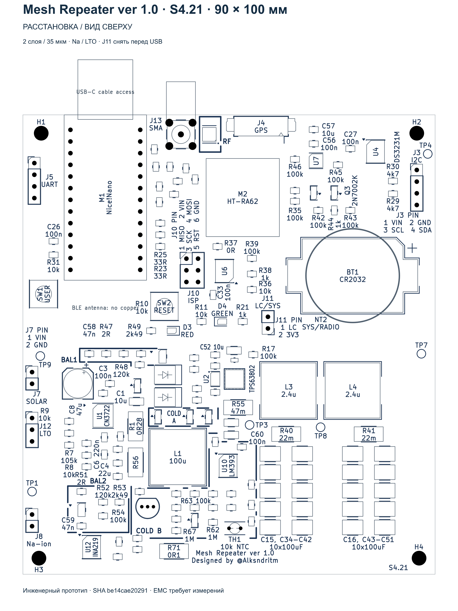

# Mesh Repeater ver 1.0

**Designed by @Alksndritm · CAD S4.21 · 18 октября 2026**

Собственные материалы — **CC BY-NC-SA 4.0**. Заказ плат для личной сборки,
включая платное изготовление подрядчиком, разрешён. Коммерческий выпуск и
продажа — только с письменного разрешения Alksndr55. [Условия и исключения](LICENSE.md).

Двухслойная плата 90 × 100 мм для MeshCore, Nice!Nano-совместимого nRF52840 и Heltec HT-RA62. За основу совместимости принят FakeTec / ProMicro. В проекте есть солнечный зарядник CN3722, TPS63802 с двухкаскадным выходным фильтром, INA219, RTC с CR2032 и watchdog на ATtiny13A. Варианты аккумулятора — Na-ion 1S и LTO 2S.



## Актуальные файлы

| Материал | Файл |
|---|---|
| Редактируемый проект KiCad 10.0.6 | [Открыть проект](design/Meshcore_NaIon/Meshcore_NaIon.kicad_pro) · [плата](design/Meshcore_NaIon/Meshcore_NaIon.kicad_pcb) · [схема](design/Meshcore_NaIon/Meshcore_NaIon.kicad_sch) |
| Весь проект одним архивом | [KiCad S4.21, 119 файлов](output/Mesh_Repeater_v1_S4_21_KiCad.zip) |
| Схема для просмотра | [PDF S4.21](output/pdf/S4_21_schematic.pdf) |
| Детали и варианты установки | [BOM: 172 позиции, три варианта](bom/S4_21_COMPONENT_BOM.csv) · [пояснения](bom/NOTES_RU.txt) |
| Сборка | [Инструкция](docs/S4_21_ASSEMBLY_GUIDE_RU.md) · [изменения S4.21](docs/S4_21_ASSEMBLY_DELTA_RU.txt) |
| Заказ пустых плат | [Gerber + Excellon S4.21](output/Mesh_Repeater_S4_21_Rezonit_Gerber.zip) · [параметры Резонит](docs/S4_21_REZONIT_ORDER_RU.txt) |
| Проверка разводки и пять видов | [Отчёт S4.21](output/S4_21_MANUAL_ROUTING_FIXES_RU.html) |

Для заказа подготовлен отдельный чистый CAM ZIP: 5 пустых плат, два слоя, FR4 1,5 мм, медь 35 мкм, маска и маркировка с двух сторон. Исходники KiCad и отчёты в производственный ZIP не входят. Условия заказа и состав файлов указаны в инструкции Резонит. Экспорт S4.20 для этой платы не подходит.

## Что изменилось

Сохранена ручная оптимизация маршрутов. Восстановлен нижний полигон земли, удалены полностью перекрытые дубли и лишние короткие участки, исправлены подключения переходных отверстий и несколько небольших ступеней. M2 возвращён в положение (48; 18 мм), его интерфейсы и цифровые порты сохранены. Рамка SH1 и тестпоинт TP6 удалены из схемы, платы и BOM; **экран и крышка в текущую сборку не входят**.

Все физические компоненты расположены спереди. Подписи, не помещающиеся сверху, находятся сзади в точной проекции соответствующих деталей. Увеличенных групповых карт и сносок нет. В каталоге проекта сохранены старые варианты CSV и исторические сведения о 3D-моделях как часть полного исходника; для сборки действуют только документы S4.21, ссылки на которые приведены выше.

## Сборка и питание

Перед закупкой выберите один столбец `Fit_NaIon`, `Fit_NaIon_NoCold` или `Fit_LTO_2S` вместе с соответствующими `Value_*` и `MPN_*`. Значения и MPN скопированы из проверенного проекта без замены деталей; сохранённые ссылки магазинов не подтверждают сегодняшнее наличие. Пустой или невыбранный MPN требует отдельного выбора перед покупкой.

**Перед подключением USB снимите J11; возвращайте шунт только после отключения USB.** Предусмотрен аппаратно доработанный Nice!Nano-клон с прямым питанием 3,3 В и отключённой аккумуляторной USB-зарядкой. TH1 — один датчик на плате либо один выносной датчик у ячейки. При установке опционального SAW S869M000S003 необходимы разрез NT1 и ограничение мощности до паспортных +13 dBm; подробнее в [инструкции сборки](docs/S4_21_ASSEMBLY_GUIDE_RU.md).

Watchdog и его файлы сохранены без изменений: [исходник](design/watchdog_reference/main.c), [Makefile](design/watchdog_reference/Makefile), [подключение и ISP](design/watchdog_reference/INTEGRATION_RU.txt). Он наблюдает TXEN, а не внутреннее состояние модема. Длительное штатное молчание тоже может вызвать сброс.

## Проверки

На точном текущем исходнике: ERC, DRC, неподключённые цепи, расхождения схемы/платы и исключения — **0**. Независимый контроль — **29/29**, силовые проверки — **14/14**. Все **111 земляных площадок и 237 земляных переходов** физически соединены общей медью. Сохранены GPIO FakeTec / ProMicro; запуск конкретной версии MeshCore и поддержка дополнительных INA219/RTC в прошивке требуют проверки на образце.

Производственный экспорт прошёл **59/59 проверок CAM**, включая соответствие меди и маски текущей плате, контур, 452 металлизированных отверстия (393 перехода и 59 выводов) и четыре неметаллизированных крепёжных отверстия. Историческая отметка ожидания независимой проверки в исходном журнале экспорта относится к моменту экспорта; итог подтверждён отдельным протоколом CAM.

- [Независимый итоговый протокол](audit/s4_21_manual_routing_review_20261017/final_checks/contract.json).
- [Силовые цепи](audit/s4_21_manual_routing_review_20261017/power/final_power_check.json) и [связность земли](audit/s4_21_manual_routing_review_20261017/power/final_returns.json).
- [Происхождение CAM-экспорта](audit/s4_21_gerber_rezonit_20261018/root/export_provenance.json) и [независимая проверка CAM](audit/s4_21_gerber_rezonit_20261018/manufacturing/cam_validation.json).
- [Состав публикации](publication_manifest.json), [хеши файлов](SHA256SUMS), [инвентаризация локальных моделей и посадочных мест](design/Meshcore_NaIon/asset_manifest.json).

Это инженерный прототип. CAD/CAM-проверки не заменяют измерение EMI, нагрева, устойчивости преобразователей, просадок при передаче и работы зарядки с выбранными аккумуляторами. Независимой OVP нет; режим без аккумулятора и его горячее отключение не квалифицированы. Известные ограничения балансира LTO и холодной зарядки сохранены в инструкции сборки.

SHA256 платы S4.21:

```text
be14cae202912ebb00e5dc758b2eae04cbe6733d4cb73df00044fdb03670fab3
```

## Открытие и происхождение

Открывайте `.kicad_pro` вместе со всем каталогом `design/Meshcore_NaIon`: локальные символы, посадочные места и STEP находятся рядом. Для внешних стандартных моделей требуется установленная библиотека KiCad 10 (`KICAD10_3DMODEL_DIR`). Модели Nice!Nano, HT-RA62 и части разъёмов приблизительные; их наличие не подтверждает механическую совместимость конкретной покупки. Сохранённые в `datasheets/` документы производителей служат справочными материалами.

PDF содержит восемь листов A3 из текущих исходников, со штампами S4.21 / 18.10.2026. Отдельные унаследованные служебные плашки внутри листов сохранили прежнюю дату; они не определяют редакцию экспортированной схемы.

Ориентир совместимости — [gargomoma/fakeTec_pcb](https://github.com/gargomoma/fakeTec_pcb), [обсуждение №26](https://github.com/gargomoma/fakeTec_pcb/issues/26); прошивка — [MeshCore](https://github.com/meshcore-dev/MeshCore). Это самостоятельная редакция платы, не официальный релиз FakeTec.

## Лицензия и заказ для личных нужд

С 18.10.2026 собственные материалы проекта публикуются под
[CC BY-NC-SA 4.0](LICENSES/CC-BY-NC-SA-4.0.txt): разрешены некоммерческие
сборка, копирование, изменения и распространение с указанием автора,
отметкой изменений и соблюдением ShareAlike при публикации производных.
Личные неопубликованные изменения публиковать не требуется.

Отдельно разрешён платный заказ печатных плат у изготовителя для собственной
некоммерческой сборки, включая получение изготовителем оплаты за эту услугу.
Коммерческий выпуск и продажа плат, наборов или готовых устройств с использованием наших
лицензируемых материалов требуют предварительного письменного разрешения
[Alksndr55](https://github.com/Alksndr55). Полные условия и границы разрешения
изложены в [LICENSE.md](LICENSE.md).

Сторонние материалы сохраняют CERN-OHL-P-2.0, CC-BY-SA-4.0 с исключением
KiCad либо другие исходные условия. Неустановленное происхождение не
объявляется собственным авторством. [Уведомления и источники](THIRD_PARTY_NOTICES.md)
и [инвентаризация](design/Meshcore_NaIon/asset_manifest.json) уточняют охват;
права на сторонние материалы не ограничиваются нашей NC-лицензией.
Аппаратная редакция и файлы CAD/CAM не изменены назначением лицензии.
